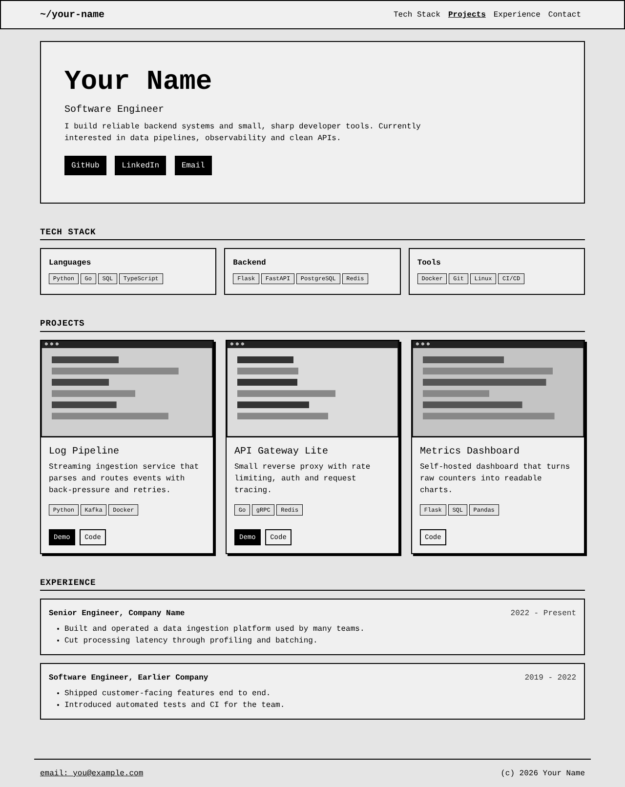
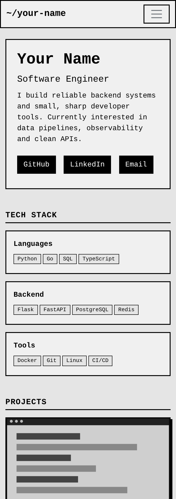

# Personal Portfolio Website (Flask + Bootstrap) — Plan & PRD

Oct 29, 2026 · Bibek Ghimire

## Summary

We will build a one-file Flask portfolio where every word, link and image is edited in a single Python dictionary, `PORTFOLIO_DATA`, and rendered through one Jinja template in a retro, monospace Bootstrap 5 style.

The product is done when the owner can add a project or job by editing only `PORTFOLIO_DATA`, reload, and see it live, with no template, CSS or JavaScript changes.

- **Audience:** hiring managers, recruiters and peers who skim for under two minutes.
- **Owner:** one Software Engineer, comfortable with Python, not wanting a CMS or database.
- **Stack:** Python 3.11+, Flask, Jinja2, Bootstrap 5 (CDN), no JavaScript beyond Bootstrap's navbar toggle.

## Problem, goals and success metrics

Portfolio sites rot because updating them means touching HTML, so new projects and jobs go unpublished for months. Site builders fix that but add cost, lock-in and generic looks. We solve it by making content data and layout code strictly separate.

| Goal | Metric | Target |
| --- | --- | --- |
| Effortless updates | Time to add a project, edit `PORTFOLIO_DATA` only | under 2 minutes |
| Zero template edits | Files changed to add a project or job | 1 (`app.py`) |
| Fast and light | Page weight excluding images; Lighthouse performance (mobile) | under 150 KB; 95 or higher |
| Accessible | Lighthouse accessibility score | 95 or higher |
| Resilient to bad data | Missing optional field crashes the page | never (graceful fallback) |

**Non-goals:** CMS or admin UI, database, user accounts, contact form backend, animations, client-side frameworks. The blog, dark mode, analytics, CV view, YAML content and Lighthouse CI are in Release 2 scope, at the end of this PRD.

## Users and key use cases

Two personas drive every decision: the owner who edits content, and the visitor who judges it quickly.

| ID | Persona | As a... I want... so that... |
| --- | --- | --- |
| U1 | Owner | add a project by copying a dictionary block, so publishing takes minutes |
| U2 | Owner | use a local file or a web URL for any image, so I choose where assets live |
| U3 | Owner | leave optional fields empty (no demo link, no image), so partial entries still look right |
| U4 | Visitor (recruiter) | see name, role and skills above the fold, so I can qualify the candidate in seconds |
| U5 | Visitor (engineer) | open the live demo and the source from each project card, so I can verify the work |
| U6 | Visitor on a phone | read a single uniform column, so nothing needs pinching or sideways scrolling |

## Functional requirements

P0 items are the launch scope you specified; P1 items are small hardening additions that protect the "edit one dict" promise.

| ID | Requirement | Priority |
| --- | --- | --- |
| FR-1 | One `app.py`; `PORTFOLIO_DATA` is defined at the very top, before imports of app logic | P0 |
| FR-2 | `PORTFOLIO_DATA` holds owner name, title, bio, social links, skills, projects, experience | P0 |
| FR-3 | Each project has `title`, `description`, `tech_stack` (list), `image_url`, `demo_link`, `code_link` | P0 |
| FR-4 | A single route `/` calls `render_template("index.html", data=PORTFOLIO_DATA)` | P0 |
| FR-5 | `index.html` loops over data to render every section; no content is hard-coded | P0 |
| FR-6 | `image_url` accepts `http(s)://` URLs or a path relative to `static/` (for example `img/app.png`) | P0 |
| FR-7 | Navbar: text brand plus anchor links to Tech Stack, Projects, Experience, Contact; links are generated from sections that have data | P0 |
| FR-8 | Hero: name, title, bio, social buttons rendered from `social_links` | P0 |
| FR-9 | Tech Stack: skills grouped by category, each skill a Bootstrap badge | P0 |
| FR-10 | Projects: Bootstrap cards in a responsive grid (1 column on mobile, 2 on tablet, 3 on desktop) with image, title, description, tags, buttons | P0 |
| FR-11 | Experience: vertical list of role, company, dates, bullet points, newest first as written | P0 |
| FR-12 | Footer: plain-text mailto link and copyright with the current year computed server-side | P0 |
| FR-13 | Empty section or missing optional field (image, demo, code link) is skipped without error; image fallback is a gray placeholder block | P1 |
| FR-14 | `if __name__ == "__main__"` runs the dev server; `debug` read from an environment variable, off by default | P1 |
| FR-15 | Page `<title>` and meta description come from `PORTFOLIO_DATA` | P1 |

### Data schema

This is the contract between the owner and the template. Field names are final; the template must not assume anything beyond it.

```python
PORTFOLIO_DATA = {
    "owner": {
        "name": "Your Name",
        "title": "Software Engineer",
        "bio": "Two or three sentences.",
        "email": "you@example.com",   # placeholder; owner supplies their own
    },
    "social_links": [
        {"label": "GitHub", "url": "https://github.com/your-handle", "icon": "bi-github"},
    ],
    "skills": {
        "Languages": ["Python", "Go"],
        "Backend": ["Flask", "PostgreSQL"],
    },
    "projects": [
        {
            "title": "Project name",
            "description": "One or two sentences.",
            "tech_stack": ["Python", "Redis"],
            "image_url": "img/project.png",   # or "https://..."
            "demo_link": "https://...",       # optional
            "code_link": "https://...",       # optional
        },
    ],
    "experience": [
        {
            "role": "Senior Engineer",
            "company": "Company",
            "dates": "2022 - Present",
            "highlights": ["Built X, which did Y."],
        },
    ],
}
```

### Content source: Python dict or YAML

YAML is a good fit, and I recommend it if you want to edit text without touching Python: keep the name `PORTFOLIO_DATA` and the schema above, but load it from a `content.yaml` file at the top of `app.py`.

| Criterion | Python dict in `app.py` | `content.yaml` loaded into `PORTFOLIO_DATA` |
| --- | --- | --- |
| Matches the brief literally | Yes | Mostly: the variable is still at the top of `app.py`, its source is the file |
| Editing feel | Quotes, commas, brackets | Less punctuation; multi-line bio with `\|` blocks |
| Typo risk | A stray quote or comma stops the site with `SyntaxError` | An indentation slip gives a parse error; same startup check applies |
| Comments | Yes | Yes |
| Dependency | None | PyYAML; always `yaml.safe_load`, never `yaml.load` |
| Gotchas | None | Unquoted values like `no`, `on`, `3.10` or `2022-01` are coerced; quote strings |
| Auto-reload while editing | Flask reloader watches `.py` files | Reloader ignores YAML unless `extra_files=["content.yaml"]` is passed |
| Edited by non-Python users | Hard | Easy |

The change is small: one loader line, one extra file, one dependency.

```python
from pathlib import Path
import yaml

PORTFOLIO_DATA = yaml.safe_load(
    Path(__file__).with_name("content.yaml").read_text(encoding="utf-8")
)
```

```yaml
owner:
  name: Your Name
  title: Software Engineer
projects:
  - title: Project name
    tech_stack: [Python, Redis]
    image_url: img/project.png   # or https://...
    demo_link: https://example.com
```

Decision: Release 1 ships with the dict, as briefed; the move to YAML is item R2-1 in Release 2 scope. The template and the schema do not change.

## Design and retro visual direction

The look is a low-fi software document: gray panels, thick black borders, monospace type, and nothing that moves. Retro comes from about 20 lines of custom CSS on top of stock Bootstrap utilities, never from a theme or a library.

| Token | Value | Use |
| --- | --- | --- |
| Font stack | `"Courier New", "Lucida Console", monospace` | Whole page, headings bold |
| Page background | `#E5E5E5` | `body` |
| Panel background | `#F0F0F0` | Cards, hero, timeline items |
| Ink and borders | `#000` (`border border-dark border-2`) | Every panel, card, button, badge |
| Link and accent | Default Bootstrap `btn-dark` / `btn-outline-dark` | Buttons, nav links |
| Corners and shadow | `border-radius: 0`; hard offset shadow `4px 4px 0 #000` on cards | Clicky, early-desktop feel |
| Motion | None; only the default `:hover` color invert | Buttons and links |

### Section behaviour

- **Navbar:** sticky-top, text brand on the left, anchor links on the right; collapses with Bootstrap's built-in toggler under 992 px.
- **Hero:** large `display-4` name, title line, bio in a bordered panel, social buttons as an icon plus label so they remain readable without the icon font.
- **Tech Stack:** one bordered panel per category, badges as `text-bg-light border border-dark`.
- **Projects:** `row row-cols-1 row-cols-md-2 row-cols-lg-3 g-4`; cards of equal height; thumbnails in a fixed 16:9 box with `object-fit: cover` so mixed image sizes align.
- **Experience:** bordered list items stacked vertically with a left rule; role and company bold, dates right-aligned on desktop and below the title on mobile.
- **Footer:** top border, plain `mailto:` text link, copyright line.

Contrast of black on `#F0F0F0` is about 19:1, which is above WCAG AAA, so the retro palette costs nothing in accessibility.

## Mock UI

Gray panels, 2 px black borders, hard card shadows and monospace type; all names and text are placeholders.

> Diagram: desktop mock, 6 sections (navbar, hero, tech stack, three project cards, experience, footer). See the live doc.

On desktop the projects sit in a three-column grid with equal-height cards.

> Diagram: mobile mock, 2 screens (top of page, and projects stacked). See the live doc.

Under 768 px the grid collapses to one uniform column and the navbar folds into the toggler.

| Mock region | Rendered from |
| --- | --- |
| Navbar | `owner.name` and the sections that have data |
| Hero | `owner.name`, `owner.title`, `owner.bio`, `social_links` |
| Tech Stack | `skills` (category name and badges) |
| Project cards | `projects` (image, title, description, `tech_stack`, `demo_link`, `code_link`) |
| Experience | `experience` (role, company, dates, highlights) |
| Footer | `owner.email`, current year, `owner.name` |

### Rendered page layout

> Diagram: page layout, 6 sections. Each section is a Bootstrap container with a row inside; Navbar `.navbar .navbar-expand-lg .sticky-top`; Hero `.container > .row > .col-12`; Tech Stack `.row .row-cols-1 .row-cols-md-3 .g-3`; Projects `.row .row-cols-1 .row-cols-md-2 .row-cols-lg-3 .g-4`; Experience `.container > .row > .col-12 > .list-group`; Footer `.container .border-top`.

These are screenshots of the working prototype rendered in a browser, built from the Release 1 spec. The diagram shows its structure: each section is a Bootstrap container with a row inside, and only the Projects grid changes column count by breakpoint.

**Desktop, 1280 px wide**



**Phone, 390 px wide (top of page)**



On the phone the navbar folds into the toggler and every grid becomes one column.

## Technical architecture

> Diagram: request flow. `PORTFOLIO_DATA` (top of `app.py`) goes to the Flask route `/` (`render_template(index.html, data)`), then to `templates/index.html` (Jinja loops render every section), then to the visitor's browser. Bootstrap 5 comes from a CDN, and images come from `static/img/` or any https URL.

The owner edits one dictionary; Flask passes it to one template; the browser pulls CSS from a CDN and images from `static/` or any URL.

**File layout:** `app.py` (data plus one route), `templates/index.html`, `static/img/` (local images), `requirements.txt` (pins Flask), `README.md` (how to edit, run and deploy).

| Decision | Choice | Why | Trade-off |
| --- | --- | --- | --- |
| Content store | Python dict at the top of `app.py` | Specified; no parser, comments allowed, instant reload | Needs a developer to edit |
| Rendering | Server-side Jinja, one template | Fast first paint, SEO-friendly, no build step | No client-side interactivity |
| Image paths | A small Jinja test: values starting with `http` are used as-is, others go through `url_for('static', ...)` | One field supports local and hosted images | Typos in paths show the placeholder, not an error |
| Bootstrap delivery | CDN with pinned version and SRI hash | Zero setup, cached across sites | Needs network; can be vendored later |
| Routing | One route `/`, section anchors | Matches the one-page brief | No per-project pages |
| Serving | Flask dev server locally; `gunicorn app:app` when hosted | Standard, tiny | Dev server must not face the internet |

## Non-functional requirements

| Area | Requirement | How we meet it |
| --- | --- | --- |
| Performance | Page weight under 150 KB excluding images; no render-blocking custom JS | Bootstrap CSS from a CDN with a pinned version; one small inline style block; zero app JavaScript |
| Images | Thumbnails do not shift layout or bloat the page | Fixed aspect-ratio box, `loading="lazy"`, `width`/`height` hints; recommend images under 200 KB |
| Accessibility | WCAG 2.1 AA | Semantic landmarks (`nav`, `main`, `section`, `footer`), one `h1`, meaningful `alt` text from `title`, visible focus rings, skip link |
| Responsive | No horizontal scroll from 360 px to 1920 px | Bootstrap grid and `row-cols-*`; `img-fluid` |
| Security | No XSS from content; safe external links | Jinja autoescape stays on (never `\|safe`); external links use `rel="noopener noreferrer"`; production debug off |
| SEO | Indexable, readable previews | Server-rendered HTML, `<title>`, meta description, Open Graph title and description from data |
| Maintainability | New developer understands it in 10 minutes | Two files plus `static/`; comments above `PORTFOLIO_DATA` explaining each field |
| Portability | Runs anywhere Python runs | `requirements.txt` pins Flask; works on any WSGI host with `gunicorn app:app` |
| Browser support | Last 2 versions of Chrome, Firefox, Safari, Edge | Bootstrap 5 baseline; no experimental CSS |

## Optimized delivery plan and test plan

> Diagram: delivery plan, 5 phases each closed by a pass-or-fail gate, about three days. 1 Scaffold and data (about 0.5 day), gate: page renders owner name from the dictionary. 2 Build the sections (about 1 day), gate: adding a project or job needs only a dict edit. 3 Retro style and responsive (about 0.5 day), gate: no sideways scroll from 360 to 1920 px. 4 Harden and QA (about 0.5 day), gate: Lighthouse 95+ on mobile; bad data cannot crash. 5 Deploy (about 0.5 day), gate: live URL loads; README steps work end to end.

The plan is ordered so the riskiest promise, editing data only, is proven in phase 2 before any styling effort. Estimates are for one developer and assume no hosting surprises.

| Test | Method | Pass condition |
| --- | --- | --- |
| Data-only edit | Add one project and one job to `PORTFOLIO_DATA`, reload | Both appear; the diff touches only `app.py` |
| Missing fields | Remove `image_url`, `demo_link`, `code_link`; empty one skill category | Page returns 200; placeholder shown; no empty buttons or headings |
| Image modes | Use a `static/img/` path, an `https` URL, and a wrong path | First two render; the third shows the placeholder |
| Responsive | View at 360, 768 and 1280 px | Projects show in 1, 2 and 3 columns; no horizontal scroll |
| Escaping | Put `<script>` in a description | Shown as text, not executed |
| Accessibility | Lighthouse plus keyboard-only pass | Score 95 or higher; every link and button reachable with a visible focus ring |
| Automated smoke | `pytest` with Flask's test client | `GET /` returns 200 and contains the owner name and every project title |

## Risks, open questions and future enhancements

| Risk | Likelihood | Mitigation |
| --- | --- | --- |
| A typo in `PORTFOLIO_DATA` breaks the whole page | Medium | Template uses `.get()` and `if` guards; add a startup check that validates required keys and fails with a clear message |
| Broken or heavy images hurt the look and speed | Medium | Fixed-ratio box with gray placeholder; image size guideline in the comments |
| CDN outage removes all styling | Low | Pin Bootstrap version with an SRI hash; optional step to vendor the CSS into `static/` |
| Retro style reads as unprofessional | Low | Keep copy concise, contrast high, layout conventional; only the surface is retro |
| Content in code is awkward for non-developers | Low | Acceptable: the owner is a developer; JSON or YAML moves are a future option |

**Open questions for the owner:**

- [x] Hosting target: PythonAnywhere, Render, Fly.io, or a VPS? It decides the `gunicorn` and static-file setup.
- [x] Social icons: Bootstrap Icons via CDN (extra request) or text-only buttons?
- [x] Should Contact be a plain `mailto:` only, as specified, or also a copy-email button later?
- [x] Is a custom domain and HTTPS needed at launch?

## Release 2 scope

Release 2 adds six features on top of the shipped Release 1 site, about 4 days of work in total (estimates, one developer). Release 1 stays lean; every item below is additive and must not break the Release 1 acceptance gates.

| ID | Feature | Requirement | Acceptance |
| --- | --- | --- | --- |
| R2-1 | Content in `content.yaml` | Move the data into `content.yaml`, loaded with `yaml.safe_load` into `PORTFOLIO_DATA`; same schema; startup check names the missing key or bad line; reloader watches the file in debug | Editing the YAML alone changes the site; a bad file fails with a readable message |
| R2-2 | Print-friendly CV at `/cv` | New route and `cv.html` built from the same data (owner, skills, experience, project titles); `@media print` CSS: no navbar, black on white, no shadows, fits 1 to 2 A4 or Letter pages; linked from the footer | Browser print preview shows a clean CV with no cut-off blocks; no extra JavaScript |
| R2-3 | Blog from Markdown files | `posts/*.md` with YAML front matter (`title`, `date`, `summary`, `tags`, `draft`); routes `/blog` and `/blog/<slug>`; posts parsed once at startup (re-read in debug); Markdown rendered with a library, output sanitised, code highlighted with Pygments CSS | A new `.md` file appears in the list after restart; `draft: true` is hidden; unknown slug returns 404; `<script>` in a post is stripped |
| R2-4 | Dark mode | Colors as CSS custom properties; dark palette applied through `prefers-color-scheme: dark`; no toggle and no JavaScript in this release | Both palettes keep text contrast at 4.5:1 or better; thick borders stay visible in dark |
| R2-5 | Analytics | Cookieless, privacy-friendly tool, switched on by one `analytics` key in the data; empty key means no script; no cookie banner | Page weight rises by one small script only; nothing loads when the key is empty |
| R2-6 | Lighthouse check in CI | `lhci` run on every push against `/`, `/cv` and `/blog` using the mobile preset, with assertions of 0.95 or higher for performance, accessibility, best practices and SEO; `pytest` smoke tests run in the same pipeline | The pipeline fails below any threshold and stores the report as an artifact |

### Order and design notes

1. **R2-1 YAML first,** because the blog's front matter and the CV reuse the same loader and validator.
2. **R2-6 Lighthouse CI second,** so every later feature is measured against the 0.95 gates as it lands.
3. **R2-2 CV and R2-4 dark mode,** both small and CSS-led.
4. **R2-3 blog,** the largest item. It breaks the "one template" rule of Release 1, so it adds `blog_index.html` and `post.html`, and moves blog code to `blog.py` if it exceeds about 60 lines. Slugs come from a whitelist of file names to prevent path traversal.
5. **R2-5 analytics last,** because it is the only third-party script and the only exception to "no app JavaScript".

**New files:** `content.yaml`, `templates/cv.html`, `templates/blog_index.html`, `templates/post.html`, `posts/*.md`, `lighthouserc.json`, and the CI config file.

**Open questions for Release 2:**

- [ ] Which analytics tool: Plausible, Umami or GoatCounter? It sets the script origin and the data-protection note.
- [ ] CI host: GitHub Actions or GitLab CI?
- [x] Should dark mode get a manual toggle later, accepting a few lines of JavaScript and `localStorage`?
- [ ] Should the blog get an RSS feed and sitemap, or stay a plain list?
